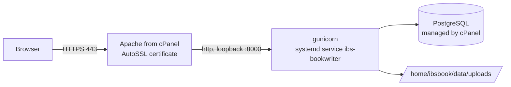

# Deploying on an InMotion VPS (books.infodine.net)

Target: an **InMotion managed VPS with cPanel & WHM on AlmaLinux 9**, the site at `https://books.infodine.net`, open sign-up.

> **Status: written from documentation, not yet run on a real InMotion VPS.** The application side (gunicorn, PostgreSQL, the settings) is the same as the tested setup in [DEPLOYMENT.md](DEPLOYMENT.md), part 2. The AlmaLinux package names and cPanel/WHM steps are the standard ones, but expect to fix a small thing or two on the first run. If a step fails, send the exact error and the output of the command named in its *Check* line.

## Why this setup

- **The Core shared plan cannot run this app**: no Pango libraries (needed for every export format), Python 3.6, no way to install system packages. Use a VPS.
- **It must be AlmaLinux 9.** WeasyPrint 70 needs Pango 1.44 or newer and Python 3.10 or newer. AlmaLinux 9 has Pango 1.48 and Python 3.11/3.12. AlmaLinux 8 has Pango 1.42, which is too old. When you order, confirm the image is **AlmaLinux 9** and that you get **root SSH access**.
- **cPanel owns ports 80 and 443**, so gunicorn runs on loopback port 8000 and cPanel's Apache proxies the site to it. cPanel's AutoSSL provides the free HTTPS certificate and renews it.



Sizes used below: user and account name `ibsbook`, code in `/home/ibsbook/app`, uploads in `/home/ibsbook/data/uploads`, database `ibsbook_books`, database user `ibsbook_app`. Change them if you like, but change them everywhere.

## Step 1 - Order and first login

Order the managed VPS **with cPanel & WHM** (AlmaLinux 9). 4 vCPU and 8 GB RAM is plenty. Note the server's IP address, and log in as root:

```bash
ssh root@SERVER-IP
cat /etc/os-release | head -3        # Check: AlmaLinux 9.x
```

## Step 2 - Point books.infodine.net at the VPS

`infodine.net` itself stays on your Core plan. Only the `books` name moves.

1. Log in to the **cPanel of your Core account**, open **Zone Editor**, choose `infodine.net`, **Manage**.
2. Add an **A** record: name `books`, address = the VPS IP, TTL 300.
3. Check from your own computer (can take a few minutes): `getent hosts books.infodine.net` shows the VPS IP.

## Step 3 - Create the cPanel account that owns the site

1. In **WHM** (`https://SERVER-IP:2087`, root login): **Account Functions, Create a New Account**.
2. Domain `books.infodine.net`, username `ibsbook`, a strong password, a package with enough disk (the books and images are small, but allow some GB).
3. Create it.

## Step 4 - System packages

```bash
dnf install -y python3.12 python3.12-pip pango fontconfig git
python3.12 --version                              # Check: 3.12.x
python3.12 -c "print('ok')" && rpm -q pango       # Check: pango 1.48 or newer
```

(`python3.11` also works.) The program carries its own fonts, so no font packages are needed.

## Step 5 - PostgreSQL

cPanel manages PostgreSQL itself, so use its tools:

1. **WHM, SQL Services, PostgreSQL Configuration**: click **Install Config** if it is not installed yet.
2. Log in to the **cPanel of the `ibsbook` account** (WHM, List Accounts, click the cPanel icon). Open **PostgreSQL Databases**.
3. Create the database `books` (cPanel names it `ibsbook_books`). Create a user `app` (`ibsbook_app`) with a long random password. **Add the user to the database with ALL privileges.**

> **Simplest alternative: SQLite.** For a small site you can skip steps 5 and 6's database parts: put `IBS_DB=sqlite` in `.env` and the app keeps everything in one file (`ibsbook.db` in the app folder), creating its tables on first start. PostgreSQL is better once many people write at the same time.

## Step 6 - Install the application

Run these as root; `runuser` runs each command as the `ibsbook` user.

```bash
cd /home/ibsbook
runuser -u ibsbook -- git clone https://github.com/athanasius1024/IBS-book-writer-app.git app
cd app
runuser -u ibsbook -- git checkout v1_0          # a release tag (or a specific commit), not a moving branch
runuser -u ibsbook -- python3.12 -m venv .venv
runuser -u ibsbook -- .venv/bin/pip install -r requirements-prod.txt
runuser -u ibsbook -- mkdir -p /home/ibsbook/data/uploads
```

If the repository is private, use a deploy key or token (do not paste a token into shell history). Until `v1_0` exists as a tag, use the commit you want to run.

Create the tables and the configuration file (the script is safe to re-run; it asks for the password and writes `.env`):

```bash
runuser -u ibsbook -- env DB_HOST=localhost DB_PORT=5432 DB_NAME=ibsbook_books DB_USER=ibsbook_app ./setup_database.sh
```

Then edit `/home/ibsbook/app/.env` and add or confirm:

```ini
SESSION_COOKIE_SECURE=1
ALLOW_REGISTRATION=0
UPLOAD_DIR=/home/ibsbook/data/uploads
```

`ALLOW_REGISTRATION` stays `0` until step 7. (For SQLite instead, drop the `DB_*` lines and add `IBS_DB=sqlite`.)

## Step 7 - Start it, and create the administrator before the site is public

**Important:** the app lets anyone register while it has *no accounts at all*, even with `ALLOW_REGISTRATION=0`, and the first account becomes the administrator. So create that account yourself before the web server exposes the app.

```bash
cp /home/ibsbook/app/deploy/inmotion/ibs-bookwriter.service /etc/systemd/system/
systemctl daemon-reload
systemctl enable --now ibs-bookwriter
systemctl status ibs-bookwriter --no-pager
curl -s -o /dev/null -w '%{http_code}\n' http://127.0.0.1:8000/login      # Check: 200
journalctl -u ibs-bookwriter -n 30 --no-pager                           # if not
```

Now reach it privately through an SSH tunnel. On **your own computer**:

```bash
ssh -L 8000:127.0.0.1:8000 root@SERVER-IP
```

Leave that open, browse to `http://127.0.0.1:8000/register` on your computer, and **create your account** (it is the administrator). Then, on the server, open sign-up to everyone and restart:

```bash
sed -i 's/^ALLOW_REGISTRATION=.*/ALLOW_REGISTRATION=1/' /home/ibsbook/app/.env
systemctl restart ibs-bookwriter
```

## Step 8 - Let cPanel's Apache proxy the site, with HTTPS

```bash
httpd -M 2>/dev/null | grep -E 'proxy_http|headers|rewrite'     # Check: all three listed
```

If one is missing: `dnf install ea-apache24-mod_proxy ea-apache24-mod_proxy_http ea-apache24-mod_headers` (or enable it in WHM, EasyApache 4).

Install the two include files cPanel reads for this domain:

```bash
mkdir -p /etc/apache2/conf.d/userdata/ssl/2_4/ibsbook/books.infodine.net \
         /etc/apache2/conf.d/userdata/std/2_4/ibsbook/books.infodine.net
cp /home/ibsbook/app/deploy/inmotion/apache-ssl-proxy.conf \
   /etc/apache2/conf.d/userdata/ssl/2_4/ibsbook/books.infodine.net/ibs-proxy.conf
cp /home/ibsbook/app/deploy/inmotion/apache-http-redirect.conf \
   /etc/apache2/conf.d/userdata/std/2_4/ibsbook/books.infodine.net/ibs-redirect.conf
/scripts/ensure_vhost_includes --user=ibsbook
httpd -t                                   # Check: Syntax OK
/scripts/restartsrv_httpd
```

Get the certificate (AutoSSL also does this on its own schedule): **WHM, SSL/TLS, Manage AutoSSL**, or

```bash
/usr/local/cpanel/bin/autossl_check --user=ibsbook
```

Then check from your own computer:

```bash
curl -sI https://books.infodine.net/login | head -3         # Check: HTTP/2 200, valid certificate
curl -sI http://books.infodine.net/login  | head -3         # Check: 301 to https
```

If the HTTPS site works but you cannot log in or are logged out straight away, the app is not being told the visitor used HTTPS: check that the `RequestHeader` lines are in the proxy file and `mod_headers` is loaded.

## Step 9 - Backups

The server is **not backed up by default**. Schedule the backup script as the `ibsbook` user and copy the result off the machine.

```bash
runuser -u ibsbook -- bash -c 'printf "localhost:5432:*:ibsbook_app:THE-DB-PASSWORD\n" >> ~/.pgpass && chmod 600 ~/.pgpass'
cat > /etc/cron.d/ibs-bookwriter-backup <<'EOF'
15 2 * * * ibsbook DB_NAME=ibsbook_books DB_USER=ibsbook_app UPLOAD_DIR=/home/ibsbook/data/uploads BACKUP_DIR=/home/ibsbook/backups /home/ibsbook/app/deploy/backup.sh >> /home/ibsbook/backup.log 2>&1
EOF
runuser -u ibsbook -- env DB_NAME=ibsbook_books DB_USER=ibsbook_app UPLOAD_DIR=/home/ibsbook/data/uploads BACKUP_DIR=/home/ibsbook/backups /home/ibsbook/app/deploy/backup.sh   # run once now: Check it succeeds
```

A backup on the same disk does not survive losing the server. Copy `/home/ibsbook/backups` elsewhere regularly (`rsync`, `rclone`, or InMotion's backup add-on). Test a restore once; the steps are in `DEPLOYMENT.md`, "Moving your existing data".

## Step 10 - Verify

1. Register a second test account at `https://books.infodine.net/register`, create a book and a chapter, then generate **all four formats** on the book's *Stored books* page. (This is the part that proves Pango and the fonts are right.)
2. Delete the test account's book. Confirm `journalctl -u ibs-bookwriter -n 50` shows no errors.
3. Reboot the server once (`reboot`) and confirm the site comes back by itself.

## Running it

```bash
systemctl status ibs-bookwriter --no-pager
journalctl -u ibs-bookwriter -f                       # live log
systemctl restart ibs-bookwriter
```

**Upgrading to a new version** (take a backup first):

```bash
cd /home/ibsbook/app
runuser -u ibsbook -- git fetch --tags && runuser -u ibsbook -- git checkout v1_1
runuser -u ibsbook -- .venv/bin/pip install -r requirements-prod.txt
runuser -u ibsbook -- bash -c 'set -a; . ./.env; set +a; PGPASSWORD="$DB_PASSWORD" psql -h "$DB_HOST" -U "$DB_USER" -d "$DB_NAME" -f sql/schema.sql'    # idempotent
systemctl restart ibs-bookwriter
```

## Open sign-up: what to expect

With sign-up open, anyone on the internet can create an account and ask the server to build PDFs, which is CPU- and memory-heavy (about 7 seconds and 190 MB for a 63-page book). The app has **no login throttling and no sign-up limit** of its own. Practical protections to put in place, roughly in order of value:

1. **Watch the server** for the first weeks: `top`, `df -h`, and the user count (the admin pages list books; `journalctl` shows the traffic).
2. **Keep `WEB_CONCURRENCY=3`** (the default) so a burst of PDF builds cannot use all memory, and keep the 8 GB size.
3. **Use CSF/cPHulk** (installed with WHM) for brute-force login protection, and consider a free Cloudflare proxy in front of the site for rate limiting.
4. If it gets abused, **close sign-up** (`ALLOW_REGISTRATION=0`, restart) and create accounts by hand, or ask for a small code change: a cap on total accounts, an invite code, or a per-user limit on builds per hour.

## Troubleshooting

- **502 or 503 from Apache:** gunicorn is down. `systemctl status ibs-bookwriter`, `journalctl -u ibs-bookwriter -n 50`.
- **Service fails with a permission error:** the unit allows writes only under `/home/ibsbook`; check `UPLOAD_DIR` is inside it and owned by `ibsbook`.
- **"cannot load library" / Pango errors in the journal:** `rpm -q pango`, `ldconfig -p | grep -E 'pango|harfbuzz|fontconfig'`.
- **`setup_database.sh` stops at "Checking connection":** it first connects to PostgreSQL's maintenance database, which a cPanel-created database user may not be allowed to do. Do its two jobs by hand, as `ibsbook`:
  ```bash
  cd /home/ibsbook/app
  runuser -u ibsbook -- bash -c 'PGPASSWORD="THE-DB-PASSWORD" psql -h localhost -U ibsbook_app -d ibsbook_books -v ON_ERROR_STOP=1 -f sql/schema.sql'
  runuser -u ibsbook -- bash -c 'umask 077; cat > .env <<EOF
  SECRET_KEY=$(python3.12 -c "import secrets; print(secrets.token_hex(32))")
  DB_HOST=localhost
  DB_PORT=5432
  DB_NAME=ibsbook_books
  DB_USER=ibsbook_app
  DB_PASSWORD=THE-DB-PASSWORD
  EOF'
  ```
  (Use a password without quotes or `$` signs, or edit `.env` afterwards.) Then carry on at the `.env` additions in step 6.
- **Database connection refused or password errors:** check `DB_*` in `.env`, that PostgreSQL runs (`systemctl status postgresql`), and that the cPanel user was added to the database with all privileges.
- **`ensure_vhost_includes` or `httpd -t` complains:** the include path must match the account and domain exactly (`ibsbook`, `books.infodine.net`); `httpd -t` names the file and line.
- **Certificate not issued:** the DNS record from step 2 must already point at this server, and port 80 must be reachable; check WHM, Manage AutoSSL, logs.
