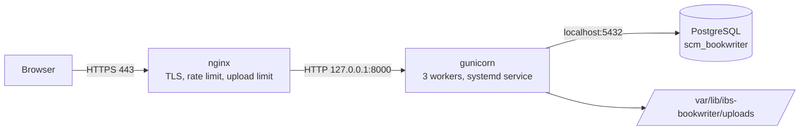

# Deployment

This document has two parts:

1. **The current setup** - what is running today, how to operate it, and where it falls short of production.
2. **Deploying to a production-grade environment** - gunicorn + systemd + nginx with HTTPS, a hardened PostgreSQL, scheduled backups, and an upgrade procedure.

**Deploying on an InMotion VPS (cPanel, AlmaLinux 9)?** Use [DEPLOYMENT-INMOTION.md](DEPLOYMENT-INMOTION.md) instead of part 2; its files are in `deploy/inmotion/`.

Ready-to-use files for part 2 are in `deploy/`: `gunicorn.conf.py`, `ibs-bookwriter.service`, `nginx-ibs-bookwriter.conf`, `backup.sh`. Production dependencies are in `requirements-prod.txt`.

---

# Part 1 - The current setup

*Snapshot updated 2026-10-20: the local instance runs the `feature/editable-contents-inline-images` code (editable Contents, pictures with crop and resize in chapter text, chapter epigraphs, stored PDF/EPUB/HTML/ODT books, version and date stamp on the Contents). Before that it ran `main` after pull request #1.*

## What is running

Everything runs on one Ubuntu machine, as the user `infodine`. "Production" at the moment means "the live data on this machine".

- **Application**: Flask's built-in development server, started with `./start.sh`. It runs `app/ibsbook.py` from `/home/infodine/z_app/IBS-book-writer-app`, with debug mode off.
- **Address**: `http://127.0.0.1:5000`, reachable only from this machine (loopback). No TLS, no reverse proxy.
- **Python**: 3.13.5 in the project's `.venv`. Dependencies come from `requirements.txt`.
- **Database**: PostgreSQL 16.9 on the same machine, also listening on loopback only. Database `db_ibs_bookwriter`, schema `scm_bookwriter`, user `rock`. It has 13 tables (`app_user`, `book`, `book_cover`, `chapter`, `content_block`, `media_asset`, `book_layout`, `book_page`, `book_author`, `book_term`, plus `book_toc_entry`, `media_derivative` and `rendered_book` added by the 2026-10-20 upgrade).
- **Configuration**: `.env` in the project root (git-ignored, mode 600) holds `SECRET_KEY` and the `DB_*` settings. Nothing else is configured.
- **Data**: two accounts - `Chuyachan` (administrator, owns a small test book) and `APA` (owns book #7, "Terran Society": 11 chapters, 74 glossary/index terms, 63-page PDF). No images have been uploaded yet; `uploads/` is created on the first upload (or the first stored book) and will then also hold `derived/` and `renders/`.
- **Logs**: `/tmp/ibs-app.log` (lost on reboot).
- **Exports**: `~/exports/Terran_Society.pdf` and `~/exports/Terran_Society.epub` were saved by hand; the app does not store exports.
- **Backups**: made by hand, in `~/backups/` (`terran-society-20261018-104612/`, `ibs-bookwriter-20261019-035253/` and `ibs-bookwriter-20261020-080531-before-contents-images/`, taken just before the 2026-10-20 schema upgrade). Nothing is scheduled.

## Operating it

Start (or restart) from the project directory:

```bash
unset DATABASE_URL BOOKWRITER_SCHEMA UPLOAD_DIR IBS_DEV PORT   # see the warning below
pkill -f ibsbook.py
(nohup ./start.sh > /tmp/ibs-app.log 2>&1 &)
```

Check it:

```bash
curl -s -o /dev/null -w '%{http_code}\n' http://127.0.0.1:5000/login    # expect 200
tail /tmp/ibs-app.log
```

> **Warning - stale environment variables win over `.env`.** `.env` never overrides variables already set in your shell. A leftover `DATABASE_URL` or `BOOKWRITER_SCHEMA` once pointed the app at the wrong database. Unset them before starting, as above.

**Updating the current setup** after new code lands on `main`:

```bash
git pull --ff-only
psql -h localhost -U rock -d db_ibs_bookwriter -f sql/schema.sql   # idempotent; adds anything new
pkill -f ibsbook.py && (nohup ./start.sh > /tmp/ibs-app.log 2>&1 &)
```

## What is stored where (and what to back up)

- **PostgreSQL** holds the text of every book, the Contents entries, the record of each stored book and of each cropped picture.
- **`UPLOAD_DIR`** (by default `uploads/` in the project) holds three kinds of file: your original pictures (`<user id>/`), cropped and downsized copies made from them (`derived/<user id>/`, rebuilt automatically when needed), and your stored books (`renders/<user id>/`: the PDF, EPUB, HTML and ODT copies, up to 10 per format per book).
- A backup is the database dump **plus** the whole `UPLOAD_DIR`. `deploy/backup.sh` already archives the whole folder. The `derived/` part could be rebuilt but is small; `renders/` can also be regenerated from the book, but only as the book is *now*, so keep it if you want old versions.
- Deleting a book deletes its stored books from disk. Deleting a picture deletes its cropped copies.
- Upgrading from a version without these features: take a backup, `psql -d db_ibs_bookwriter -f sql/schema.sql`, restart. The upgrade only adds tables and columns (`book_toc_entry`, `media_derivative`, `rendered_book`, and two epigraph columns on `chapter`).

## Gaps compared with a production deployment

These are the reasons part 2 exists:

- **Development server.** Flask itself warns against using it in production. It is not hardened and has no worker management.
- **Not supervised.** It does not start at boot and is not restarted if it crashes. Logs go to a temp file.
- **No HTTPS.** Fine on loopback; unacceptable on a network (passwords and session cookies would travel in clear text). `SESSION_COOKIE_SECURE` is not set.
- **No login throttling.** The app does not limit password guesses. Production puts that limit in the reverse proxy.
- **Registration is open.** `ALLOW_REGISTRATION` is not set, so anyone who can reach the site can create an account.
- **Backups are manual** and kept on the same disk as the data.
- **Secrets in plain files.** The database password and `SECRET_KEY` are in `.env` (mode 600). That is acceptable, but production should give the file to a dedicated service user.
- **Runs as a personal account** with access to the home directory.

---

# Part 2 - Deploying to a production-grade environment

## Architecture



- nginx is the only public listener. gunicorn and PostgreSQL listen on loopback.
- The app runs as an unprivileged system user (`ibsbook`) under a sandboxed systemd unit.
- One host is assumed. Uploaded images live on that host's disk (see "Scaling" below).

## What it needs

- Ubuntu 24.04 (or similar Debian-based Linux), with `sudo` access.
- 2 vCPU and 2-4 GB RAM is a comfortable start. Measured on the 63-page Terran book: the first PDF layout takes about 7 seconds and a worker peaks around 190 MB. Plan on a few hundred MB per concurrent PDF build.
- A DNS name pointing at the server (the examples use `books.example.com`), with ports 80 and 443 reachable.
- Python 3.13 was used for development and testing. Other recent Python 3 versions should work, but run the test suite on whatever the server provides (step 4).

## Step 1 - Install system packages

```bash
sudo apt update
sudo apt install -y git python3 python3-venv nginx certbot postgresql postgresql-client \
    libpango-1.0-0 libpangoft2-1.0-0 fontconfig fonts-liberation ufw
```

The Pango libraries and fonts are required by WeasyPrint for PDF and EPUB export. Without `fonts-liberation` the PDF silently falls back to a default serif font and pages break differently. Java is not needed on the server (it is only used by the EPUBCheck tests in development).

## Step 2 - Create the service user and install the code

```bash
sudo useradd --system --user-group --home-dir /nonexistent --shell /usr/sbin/nologin ibsbook

# The code is owned by you (the deployer), readable by everyone, writable by nobody else.
sudo mkdir -p /opt/ibs-bookwriter && sudo chown "$USER": /opt/ibs-bookwriter
git clone https://github.com/athanasius1024/IBS-book-writer-app.git /opt/ibs-bookwriter
cd /opt/ibs-bookwriter
git checkout c9a58ec            # or a release tag; deploy a specific revision, not a moving branch

python3 -m venv .venv
.venv/bin/pip install -r requirements-prod.txt
```

If the repository is private, clone with a deploy key or a token (do not paste the token into shell history; use a credential helper).

## Step 3 - PostgreSQL

Install gives you a local server that listens on loopback only. Confirm that, then create a least-privilege role that owns just this database (the schema needs no extensions and no superuser):

```bash
ss -ltn 'sport = :5432'                                    # should show 127.0.0.1, not 0.0.0.0
sudo -u postgres createuser --pwprompt ibsbook             # choose a long random password
sudo -u postgres createdb --owner ibsbook db_ibs_bookwriter
```

Give the accounts that run `psql` and backups a `~/.pgpass` so passwords never appear on a command line (one for you, and one for `root` if the nightly backup runs from root's crontab, step 9):

```bash
printf 'localhost:5432:*:ibsbook:THE-PASSWORD\n' >> ~/.pgpass && chmod 600 ~/.pgpass
```

Then create the tables and the configuration file (the script is idempotent; it prompts for the password and writes `.env`):

```bash
cd /opt/ibs-bookwriter
DB_HOST=localhost DB_PORT=5432 DB_NAME=db_ibs_bookwriter DB_USER=ibsbook ./setup_database.sh
sudo chown ibsbook:ibsbook .env          # keeps mode 600: only the service user can read it
```

> **Moving existing data?** Do not run `./setup_database.sh` yet. Restore the dump into the empty database first (see "Moving your existing data"), then run the script, which only fills in `.env` and re-applies the idempotent schema.

## Step 4 - Configure

Edit `.env` as the service user (`sudo -u ibsbook nano /opt/ibs-bookwriter/.env`). Setup has already written `SECRET_KEY` and the `DB_*` values; add or confirm the rest:

```ini
SESSION_COOKIE_SECURE=1
ALLOW_REGISTRATION=1
UPLOAD_DIR=/var/lib/ibs-bookwriter/uploads
```

| Variable | Production value and meaning |
| --- | --- |
| `SECRET_KEY` | Required, random, secret. Signs session cookies. Changing it logs everyone out; nothing else is lost. |
| `DB_HOST` `DB_PORT` `DB_NAME` `DB_USER` `DB_PASSWORD` | PostgreSQL connection. `DATABASE_URL` (a full SQLAlchemy URL) overrides them. |
| `BOOKWRITER_SCHEMA` | Leave at the default `scm_bookwriter`. |
| `SESSION_COOKIE_SECURE` | `1`. Makes the session cookie HTTPS-only. Do not set it until HTTPS works, or logins will appear to loop. |
| `ALLOW_REGISTRATION` | `1` while you create the first accounts, then `0` to close sign-up. The first account created is the administrator. |
| `UPLOAD_DIR` | Absolute path outside the code directory. The systemd unit creates `/var/lib/ibs-bookwriter` for it. Back it up. It holds your pictures, the cropped copies made from them (`derived/`) and your stored books (`renders/`). |
| `EXPORT_DIR` | Optional. A folder on the server where *Save to the export folder* copies stored books. Unset means the button is not offered. Under the systemd unit it must also be listed in `ReadWritePaths=`. |

Runtime tuning is by environment variable in the unit or shell, not by editing code: `WEB_CONCURRENCY` (workers, default 3), `GUNICORN_TIMEOUT` (default 180 s), `GUNICORN_BIND` (default `127.0.0.1:8000`).

Optionally run the tests once on this machine before going live (they use in-memory SQLite and touch no data):

```bash
.venv/bin/pip install -r requirements-dev.txt && .venv/bin/python -m pytest -q     # expect no failures (a few optional-tool tests are skipped)
```

## Step 5 - Run it under systemd

```bash
sudo cp deploy/ibs-bookwriter.service /etc/systemd/system/
sudo systemctl daemon-reload
sudo systemctl enable --now ibs-bookwriter
systemctl status ibs-bookwriter --no-pager
curl -s -o /dev/null -w '%{http_code}\n' http://127.0.0.1:8000/login      # expect 200
```

The unit runs gunicorn as `ibsbook`, restarts it on failure, starts it at boot after PostgreSQL, and sandboxes it: read-only filesystem except its own state and cache directories, no home access, no privilege escalation. Logs go to the journal: `journalctl -u ibs-bookwriter -f`.

Edit the paths in the unit if you install somewhere other than `/opt/ibs-bookwriter`.

## Step 6 - nginx with HTTPS

Point DNS at the server first. Get a certificate using the default nginx site (webroot mode, so renewals need no downtime), then install the site:

```bash
sudo certbot certonly --webroot -w /var/www/html -d books.example.com

sudo cp deploy/nginx-ibs-bookwriter.conf /etc/nginx/sites-available/ibs-bookwriter
sudo sed -i 's/books\.example\.com/YOUR.HOST.NAME/g' /etc/nginx/sites-available/ibs-bookwriter
sudo ln -s /etc/nginx/sites-available/ibs-bookwriter /etc/nginx/sites-enabled/
sudo rm -f /etc/nginx/sites-enabled/default
sudo nginx -t && sudo systemctl reload nginx
```

What the site file does, and why each part matters:

- Redirects port 80 to HTTPS (leaving `/.well-known/acme-challenge/` open so certificate renewal keeps working) and sends an HSTS header.
- Rate-limits `/login` and `/register` to about 10 requests a minute per client. **The app has no throttling of its own, so this is the only protection against password guessing.**
- Allows uploads up to 10 MB (the app itself caps a request at 8 MB) and waits up to 180 s for slow PDF builds.
- Passes `Host` and `X-Forwarded-Proto` through. This is required: over HTTPS, Flask-WTF checks that the form's `Referer` matches the `Host`. If `Host` is rewritten by the proxy, every form post fails with HTTP 400.

Certbot installs a systemd timer that renews certificates; confirm with `sudo certbot renew --dry-run`.

Prefer Caddy? This is all it needs (it obtains certificates by itself and passes `Host` and `X-Forwarded-Proto` correctly), but it has no built-in login rate limit, so add one another way:

```text
books.example.com {
    encode gzip
    reverse_proxy 127.0.0.1:8000
}
```

## Step 7 - Firewall

Allow SSH before enabling, or you will lock yourself out:

```bash
sudo ufw allow OpenSSH
sudo ufw allow 'Nginx Full'
sudo ufw enable
sudo ufw status
```

Only 22, 80 and 443 should be open. Ports 8000 (gunicorn) and 5432 (PostgreSQL) must stay closed.

## Step 8 - Create the administrator and close sign-up

Open `https://books.example.com/register` and create your account first - **the first account becomes the administrator**. Create any other accounts you need, then set `ALLOW_REGISTRATION=0` in `.env` and restart:

```bash
sudo systemctl restart ibs-bookwriter
```

With sign-up closed, new accounts cannot be created from the website; set it back to `1` temporarily when you need to add someone.

## Step 9 - Scheduled backups

`deploy/backup.sh` writes a timestamped folder containing `db.dump` (PostgreSQL custom format), `uploads.tar.gz` and `SHA256SUMS`, checks the dump is readable, and prunes folders older than `KEEP_DAYS` (default 14). Run it from root's crontab (root can read the uploads directory and `~root/.pgpass`):

```bash
sudo mkdir -p /var/backups/ibs-bookwriter && sudo chmod 700 /var/backups/ibs-bookwriter
sudo crontab -e
```

```text
15 2 * * * DB_USER=ibsbook UPLOAD_DIR=/var/lib/ibs-bookwriter/uploads BACKUP_DIR=/var/backups/ibs-bookwriter /opt/ibs-bookwriter/deploy/backup.sh >> /var/log/ibs-backup.log 2>&1
```

Run it once by hand now and confirm it prints `Backup complete`. **A backup on the same disk is not enough**: copy `/var/backups/ibs-bookwriter` to another machine or object storage (`rsync`, `rclone`), and keep the copy off the server.

**Test a restore at least once**, into a scratch database, not the live one:

```bash
sudo -u postgres createdb --owner ibsbook ibs_restore_test
pg_restore -h localhost -U ibsbook --no-owner --role=ibsbook -d ibs_restore_test /path/to/db.dump
psql -h localhost -U ibsbook -d ibs_restore_test -c 'select count(*) from scm_bookwriter.book'
sudo -u postgres dropdb ibs_restore_test
```

The same dump-and-restore was rehearsed on the current data: row counts matched and `sql/schema.sql` re-applied cleanly afterwards.

## Step 10 - Verify the deployment

- `https://books.example.com/login` loads over HTTPS, and `http://` redirects to it.
- Log in, open a book, and view **Page view** and an **EPUB** export. PDF fonts should look like Liberation Serif, not a default font.
- `sudo systemctl restart ibs-bookwriter` and `sudo reboot` both bring the site back by themselves.
- `sudo ss -ltnp` shows only nginx on 80/443 publicly; gunicorn on `127.0.0.1:8000`; PostgreSQL on `127.0.0.1:5432`.
- `sudo ufw status` shows only SSH, 80 and 443.
- A rapid series of wrong passwords at `/login` returns HTTP 429.
- A backup has run and a copy exists off the machine.

---

## Moving your existing data

To carry the current database and uploads to the new server:

1. **On the current machine**, take a final backup (stop the dev server first so nothing changes during the copy). The script reads the database password from `~/.pgpass`, or from `PGPASSWORD` if you type it at a silent prompt; never put it on the command line:

    ```bash
    pkill -f ibsbook.py
    read -rs PGPASSWORD && export PGPASSWORD      # type the database password, nothing is echoed
    DB_USER=rock BACKUP_DIR=$HOME/migrate ./deploy/backup.sh
    unset PGPASSWORD
    ```

2. **Copy the folder** it created to the new server (`scp -r`).
3. **On the new server**, right after creating the role and the empty database in step 3 and **before** running `./setup_database.sh` or starting the service, restore it. The target PostgreSQL must be the same version as the source or newer (the source here is 16.9):

    ```bash
    pg_restore -h localhost -U ibsbook --no-owner --role=ibsbook -d db_ibs_bookwriter /path/to/db.dump
    ```

    `--no-owner --role=ibsbook` makes the new role own everything, because the dump was made by `rock`. Then run `./setup_database.sh` as in step 3 to write `.env`; it applies `sql/schema.sql` again, which changes nothing.
4. **Restore uploads** if the backup contains `uploads.tar.gz` (skipped while no images have been uploaded):

    ```bash
    sudo mkdir -p /var/lib/ibs-bookwriter/uploads
    sudo tar -xzf /path/to/uploads.tar.gz -C /var/lib/ibs-bookwriter/uploads
    sudo chown -R ibsbook:ibsbook /var/lib/ibs-bookwriter && sudo chmod 750 /var/lib/ibs-bookwriter
    ```

    Image paths in the database are relative to `UPLOAD_DIR`, so the folder can live anywhere.
5. Carry on from step 4. Users will have to log in again (the `SECRET_KEY` differs); no data is affected.

---

## Upgrading to a new release

Do this for every release. Take the backup first, always.

```bash
sudo -H env DB_USER=ibsbook UPLOAD_DIR=/var/lib/ibs-bookwriter/uploads \
    BACKUP_DIR=/var/backups/ibs-bookwriter /opt/ibs-bookwriter/deploy/backup.sh
cd /opt/ibs-bookwriter
git fetch --tags && git checkout <new-tag-or-commit>
.venv/bin/pip install -r requirements-prod.txt
psql -h localhost -U ibsbook -d db_ibs_bookwriter -f sql/schema.sql    # idempotent, additive
sudo systemctl restart ibs-bookwriter
curl -s -o /dev/null -w '%{http_code}\n' https://books.example.com/login
```

`sql/schema.sql` only adds tables and columns and never drops data, so applying it to an existing database is safe. Use `sudo systemctl reload ibs-bookwriter` instead of `restart` to swap workers gracefully without dropping in-flight requests when no dependency changed.

**Rolling back:** `git checkout <previous-revision>`, reinstall requirements, restart. Because schema changes are additive, an older release normally runs fine on the newer schema. Restore the database dump only if data was actually damaged.

Check the application version actually serving: `git -C /opt/ibs-bookwriter describe --always`.

---

## Operations reference

```bash
systemctl status ibs-bookwriter                    # is it up?
journalctl -u ibs-bookwriter -f                    # live application and access log
journalctl -u ibs-bookwriter --since "1 hour ago" -p warning
sudo systemctl restart ibs-bookwriter
sudo tail -f /var/log/nginx/access.log /var/log/nginx/error.log
```

- **Health check:** `GET /login` should return 200. Use it from an uptime monitor.
- **Logs** are in the journal (rotated by journald) and in `/var/log/nginx/` (rotated by logrotate). The access log contains page URLs; treat it as private.
- **OS updates:** enable `unattended-upgrades` for security patches, and reboot occasionally for kernel updates.

## Scaling and design limits

- **Single host.** Uploaded images are on the local disk, so running the app on more than one server needs shared storage (for example NFS) mounted as `UPLOAD_DIR`. The database can move to its own server by changing `DB_HOST`.
- **Stored books are made in the request.** *Generate all four* on a large book can take several seconds (the PDF layout, then the other formats from it); with the production unit's 180 s timeout this is not a problem, and all formats of one action share one layout pass. Cropped copies are made the first time a picture is used and then reused.
- **Export cache is per worker.** The most recently built layouts are cached in memory (4 per worker) and keyed on the book's last-edit time and layout settings, so the result is always current; the first export or Page view of a book after an edit is slow (about 7 s for the Terran book) once per worker.
- **Memory.** Size `WEB_CONCURRENCY` by RAM: each worker is about 100 MB idle and several hundred MB while building a large book. Gunicorn recycles workers every ~1000 requests to cap growth.
- **The administrator's "Database settings" page** writes `config/db_config.json` inside the code directory. Under the production unit the code directory is read-only, so that page cannot save. Use `.env` for database settings in production (environment values take precedence over that page anyway).

## Troubleshooting

- **502 Bad Gateway from nginx:** gunicorn is down. `systemctl status ibs-bookwriter` and `journalctl -u ibs-bookwriter -n 50`.
- **504 on PDF/EPUB export:** a very large book exceeded the timeout. Raise `GUNICORN_TIMEOUT` and nginx's `proxy_read_timeout` together.
- **HTTP 400 on every form (login, save) over HTTPS:** nginx is not passing `Host` and `X-Forwarded-Proto`; see step 6.
- **Login succeeds but you are immediately logged out:** `SESSION_COOKIE_SECURE=1` is set but you are browsing over plain `http://`.
- **`RuntimeError: SECRET_KEY is not set` in the journal:** `.env` is missing, not owned by `ibsbook`, or `SECRET_KEY` is empty.
- **Database connection errors:** check `DB_*` in `.env`, that PostgreSQL is running (`systemctl status postgresql`), and the password in `.pgpass`/`.env`. Connection settings given as environment variables override `.env`.
- **PDF text in the wrong font, or pages break differently from the Page view you saw before:** `fonts-liberation` is not installed on this server.
- **Uploads fail with a permission error:** `/var/lib/ibs-bookwriter/uploads` must be owned by `ibsbook`.

## Reference: optional checking tools (development only)

The tests use these when they are installed and skip them otherwise, so nothing here is needed to run the app:

- **Java** and `epubcheck` (installed with `requirements-dev.txt`) validate generated EPUBs.
- The **ODF validator** checks generated ODT files. Download `odfvalidator-0.13.0-jar-with-dependencies.jar` from Maven Central (`org/odftoolkit/odfvalidator`) to `~/.cache/ibs-tools/odfvalidator.jar`, or point `ODF_VALIDATOR_JAR` at it.
- **LibreOffice** (`soffice`) is used to open a generated ODT and convert it to PDF as a real-world check.
- **Node.js** runs the crop-maths unit tests (`tests/js/images.test.js`); `tests/browser/dialog.test.js` drives the Insert image dialog in a real Chromium (instructions in its header).

## Reference: the desktop edition (one person, one computer)

The desktop edition is the same app in a single downloadable program; see the README for how people use it. What matters to whoever supports it:

- **Where things are.** One data folder (`%APPDATA%\IBS Book Writer`, or `~/.local/share/ibs-book-writer`, or `--data-dir`, or the `IBS_DATA_DIR` variable; mode 700 on Linux): `ibsbook.db` (SQLite, in WAL mode, so `-wal` and `-shm` files appear beside it while running), `uploads/` (pictures, cropped copies, stored books), `secret_key` (mode 600, made on first run), `fontconfig/` (a generated font file and cache), `running.json` (which port the running copy uses) and, if PostgreSQL was set up, `.env`.
- **Backup and restore.** Close the program and copy the folder (while it runs, copy `ibsbook.db` only together with its `-wal` file, or stop it first). Restoring is copying it back. Losing `secret_key` only signs everyone out.
- **Upgrading.** Replace the program file with the new one. At start-up it creates anything missing and runs numbered database migrations once each (`PRAGMA user_version`; see `app/dbinit.py`), keeping all data. A data folder written by a *newer* program is refused by an older one rather than damaged.
- **PostgreSQL.** Running the program with `--setup-postgres` asks for host, port, database and user (and password), creates the database if it does not exist, applies `sql/schema.sql` and saves the settings in the data folder's `.env` (mode 600). Setting `DB_HOST`, `DB_NAME` or `DATABASE_URL` in that file or the environment has the same effect, and `IBS_DB=sqlite` forces the built-in database. There is no tool to move data between SQLite and PostgreSQL.
- **Network.** It binds to loopback only and uses the Waitress server with 8 threads. It is a single-user program: do not put it behind a proxy for other people. Use parts 1 and 2 for that.
- **Building.** `packaging/ibsbook.spec` is the PyInstaller recipe. WeasyPrint loads Pango, HarfBuzz and fontconfig at run time with `dlopen`, which PyInstaller cannot see, so the recipe collects them itself (on Linux the closure found with `ldconfig` and `ldd`, minus the C library; on Windows the DLLs that `packaging/build_windows.ps1` copies from MSYS2). A Linux build needs a C library at least as old as the oldest computer it should run on, so release builds are made on Ubuntu 22.04 (glibc 2.35). `packaging/smoke_test.py FILE` starts a finished program with a throw-away data folder and checks the whole path: sign-up, a book with every block type, all four stored formats, replace and delete.
- **Windows caveats.** The `.exe` is unsigned (SmartScreen warns on first run; some antivirus tools flag PyInstaller programs, so publish `SHA256SUMS` and, if it matters, sign the file with a code-signing certificate). A one-file program unpacks itself into a temporary folder every start, which takes a few seconds and may be slowed by antivirus scanning.
- **Versions and releases.** The program's version is one setting, `APP_VERSION` in `app/version.py` (now `1_0`). It names the files (`IBSBookWriter_v1_0.exe`, `ibs-book-writer-linux-x86_64_v1_0`), the console window, `--version` and the page header and footer; the build scripts, the spec and the CI workflow all read or glob it. It is separate from a *book's* own version number. **To release the next one:** change `APP_VERSION` (`1_0` to `1_1`), commit, push, then `git tag v1_1 && git push origin v1_1`. The tag makes `.github/workflows/build-desktop.yml` build both programs, smoke-test them, and attach them and `SHA256SUMS` to a GitHub Release. If the database needs a change, also append a numbered entry to `MIGRATIONS` in `app/dbinit.py`. Editing files under `.github/workflows/` needs a token with the `workflow` scope (or the GitHub web editor).
- **Troubleshooting a Windows build.** The step *Install MSYS2 with Pango* can fail with a corrupted-package checksum; that is a package-mirror hiccup, so re-run the failed job. If the smoke test fails, `build_windows.ps1` prints the output of `packaging/diagnose_fonts.py`, which shows what fontconfig and WeasyPrint did on that machine. One Windows-specific rule is built in: the MSYS2 libraries use the old C runtime, which keeps its own copy of the environment, so `app/desktop.py` sets `FONTCONFIG_FILE` and `FONTCONFIG_PATH` there as well (without that, PDFs fall back to the system's Times New Roman).

## Reference: development and single-user use

Run on your own machine:

```bash
./start.sh        # creates .venv, a .env with a generated SECRET_KEY, then starts the dev server on 127.0.0.1:5000
```

Database setup for a new machine: `./setup_database.sh` (prompts for host, port, database name and user, creates the database if needed, applies `sql/schema.sql`, and writes `.env`). Unattended: export `DB_HOST DB_PORT DB_NAME DB_USER DB_PASSWORD` first (an empty `DB_PASSWORD` uses `~/.pgpass` or peer authentication).

Tests (in-memory SQLite, no database server needed):

```bash
.venv/bin/pip install -r requirements-dev.txt
.venv/bin/python -m pytest tests
```
